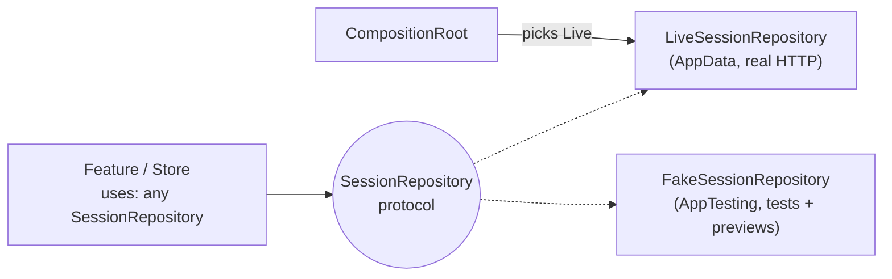
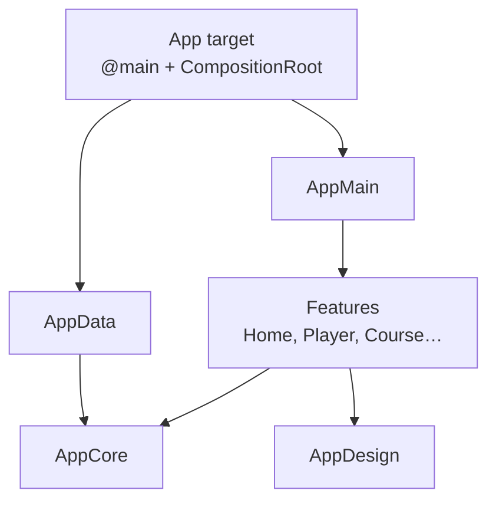

# iOS Swift

The language behind MotivationFit

<div class="pt-8 opacity-70">
Khiem Duong · Part 1 of 3
</div>

<!--
Hi everyone. I'm opening the iOS session. My part is the Swift language itself:
what the code in our app is written WITH. Khoa follows with components and state,
then Kiet with MVVM. Every example today is real code from our repo.
-->

---

# Where this talk sits

<div class="grid grid-cols-3 gap-6 pt-6">
<div class="p-4 rounded border-2 border-teal-500">

### 1 · iOS Swift
**Khiem**

Types, protocols, errors, concurrency, modules

</div>
<div class="p-4 rounded border opacity-60">

### 2 · Components + State
**Khoa**

SwiftUI views, `@State`, `@Observable`, `@Environment`

</div>
<div class="p-4 rounded border opacity-60">

### 3 · MVVM
**Kiet**

Views ↔ models ↔ stores ↔ repositories

</div>
</div>

<div class="pt-10">

**Today's path:** Setup → Value types → Protocols & generics → Errors → **Concurrency** → Modules & tooling

</div>

<!--
Three parts that build on each other. I cover the language; when I touch
@Observable or @State I'll only say what they are as Swift features and leave
the "how" to Khoa.
-->

---
layout: fact
---

# 318 Swift files
in `ios/Packages/MotivationFitKit` (+ the app target)

<div class="grid grid-cols-4 gap-4 pt-8 text-left text-sm">
<div><b class="text-2xl">287</b><br>structs</div>
<div><b class="text-2xl">67</b><br>final classes</div>
<div><b class="text-2xl">~260</b><br><code>await</code>s</div>
<div><b class="text-2xl">170</b><br><code>Sendable</code></div>
<div><b class="text-2xl">27</b><br>protocols</div>
<div><b class="text-2xl">0</b><br><code>@unchecked Sendable</code></div>
<div><b class="text-2xl">78</b><br>Swift Testing files</div>
<div><b class="text-2xl">114</b><br><code>#Preview</code>s</div>
</div>

<!--
A quick feel for the codebase. Structs outnumber classes four to one. Concurrency
is everywhere. And zero @unchecked Sendable — I'll explain why that number matters.
-->

---
layout: section
---

# 1 · The setup
Swift 6, strict from day one

---

# The rules we compile under

From `ios/AGENTS.md`, hard rules 4–6:

<v-clicks>

- **Swift 6 language mode** → complete strict concurrency checking
- **Warnings are errors** → nothing "temporary" survives a build
- The app target **defaults to `MainActor`**
- No `@unchecked Sendable` / `nonisolated(unsafe)` without a written proof
- **iOS 18 minimum**; newer API behind `#available` with a fallback
- Observation only: `@Observable`, `@State`, `@Environment`, `@Bindable` — no `ObservableObject`, no `print`

</v-clicks>

<!--
These aren't style preferences: the compiler enforces them. Swift 6 mode turns
data-race warnings into errors. The point: if it builds, a whole class of
threading bugs is already gone.
-->

---

# `Package.swift`: the compiler settings

```swift {all|1|2-6|7-8|all}
// swift-tools-version: 6.2  ·  platforms: [.iOS(.v18)]
let strict: [SwiftSetting] = [
    .treatAllWarnings(as: .error),
    .enableUpcomingFeature("NonisolatedNonsendingByDefault"),  // SE-0461
    .enableUpcomingFeature("InferIsolatedConformances"),       // SE-0470
    .enableUpcomingFeature("MemberImportVisibility")]          // SE-0444
/// UI targets: the main actor by default, like the app target.
let mainActorUI: [SwiftSetting] = strict + [.defaultIsolation(MainActor.self)]
```

<v-click>

| Setting | Means |
|---|---|
| `NonisolatedNonsendingByDefault` | an `async` func runs on its **caller's** actor; leaving it needs `@concurrent` |
| `defaultIsolation(MainActor.self)` | UI modules: every type is `@MainActor` unless said otherwise |
| `MemberImportVisibility` | a file sees a module's members only if **it** imports that module |

</v-click>

<!--
Swift 6.2 "approachable concurrency". Two settings worth remembering:
default main-actor isolation for UI targets — so view code needs no annotations —
and nonisolated-nonsending: an async function doesn't silently hop to a background
thread anymore. Non-UI modules like AppCore stay nonisolated.
-->

---

# The entry point

`App/Sources/MotivationFit.swift`

```swift {all|1-2|3-4|6-9|12-18}
@main
struct MotivationFit: App {
    @UIApplicationDelegateAdaptor(AppDelegate.self) private var delegate
    @State private var model: AppModel

    init() {
        let model = CompositionRoot.makeAppModel()
        _model = State(initialValue: model)
    }

    var body: some Scene {
        WindowGroup {
            RootView(model: model, paywallContent: CompositionRoot.paywallContent)
                .environment(\.sxImageLoader, model.images)
                .onOpenURL { model.open($0) }
        }
    }
}
```

<v-click>

`@main` · a **struct** conforming to a protocol (`App`) · property wrappers (`@State`) · opaque type `some Scene` · trailing closures

</v-click>

<!--
The whole app starts from a struct. Already five language features in 15 lines:
@main attribute, protocol conformance, property wrappers, opaque return type,
trailing closures. _model is how you initialize a property wrapper's storage directly.
-->

---
layout: section
---

# 2 · Value types
structs and enums first

---

# struct by default

```swift
/// An admin-defined tag ("Guided Meditations"); Explore's shelves are tags.
public struct CatalogTag: Codable, Sendable, Hashable, Identifiable {
    public let id: UUID
    public let slug: String
    public let name: String
}
```

<div class="grid grid-cols-2 gap-6 pt-4">
<div>

### Why struct?

<v-clicks>

- **Value semantics**: a copy is a copy, nobody mutates it behind you
- `let` properties → immutable, safe to share
- **`Sendable` for free** when all fields are `Sendable`
- Conformances are **synthesized**: `Codable`, `Hashable`, `Equatable`

</v-clicks>

</div>
<div>

### When class?

<v-clicks>

- Identity matters: one shared, changing thing
- Our 67 classes: stores, players, view models — all `final`
- `final` → no subclassing, static dispatch

</v-clicks>

</div>
</div>

<!--
287 structs vs 67 classes. Models are structs. Classes appear only where we need a
single shared instance that changes over time — stores and view models — and they
are always final. We basically never use inheritance.
-->

---

# Enums with associated values

`Core/AppCore/Models/Catalog.swift`

```swift {all|2-3|5-10|all}
public enum CatalogItem: Equatable, Sendable, Identifiable {
    case session(SessionCard)
    case program(ProgramCard)

    public var id: UUID {
        switch self {
        case .session(let session): session.id
        case .program(let program): program.id
        }
    }
}
```

<v-clicks>

- One list, two kinds of rows — **impossible states can't be built**
- `switch` is **exhaustive**: add a case → every switch fails to compile until handled
- `switch` is an **expression** (Swift 5.9): no `return` needed

</v-clicks>

<!--
Explore shows a mixed list of sessions and courses. Instead of an optional
session and an optional program — where both could be nil — the enum says
"exactly one". The compiler forces every switch to handle new cases.
-->

---

# Raw-value enums + defensive decoding

`Core/AppCore/Models/Session.swift`

```swift {all|1-3|6|8-11}
public enum SessionType: String, Codable, Sendable, Hashable {
    case talk = "TALK"
    case guided = "GUIDED"
    // ... moment, motivation, sleepTalk, sleepGuided, conversation
    case unknown

    public init(from decoder: any Decoder) throws {
        let raw = try decoder.singleValueContainer().decode(String.self)
        self = SessionType(rawValue: raw) ?? .unknown
    }
}
```

<v-click>

The backend adds `"PODCAST"` tomorrow → old app builds decode it as `.unknown` instead of **failing the whole page**.

`??` nil-coalescing · failable `init?(rawValue:)` · a custom `Decodable` init

</v-click>

<!--
Real production concern: an app on the App Store can't be updated instantly.
A new backend enum value would crash decoding. This custom init maps anything
unknown to .unknown.
-->

---
layout: section
---

# 3 · Protocols & generics
program to an interface

---

# Protocol-oriented repositories

`Core/AppCore/Repositories/Repositories.swift`

```swift {all|1-4|6-9|11-14}
public protocol ItemRepository: Sendable {
    func items(reload: Bool) async throws -> [Item]
    func item(id: String) async throws -> Item
}

public protocol SessionRepository: Sendable {
    func sessions(page: Int, pageSize: Int, reload: Bool) async throws -> SessionPage
    func session(id: UUID, context: CourseRef?) async throws -> SessionDetail?
}

public extension SessionRepository {
    /// A session opened outside any course.
    func session(id: UUID) async throws -> SessionDetail? { try await session(id: id, context: nil) }
}
```

<v-clicks>

- A protocol = a **contract**; features only ever see this
- Protocols can require `Sendable` and `async throws`
- **Protocol extensions** add default behaviour to every conformer

</v-clicks>

<!--
27 protocols in AppCore. A feature never sees an endpoint or URL — only these.
The extension gives every repository a convenience overload for free.
-->

---

# One protocol, many implementations



```swift
public struct LiveSessionRepository: SessionRepository {
    let client: SXClient
    let base: String

    public func session(id: UUID, context: CourseRef?) async throws -> SessionDetail? {
        try await client.read(GetSession(base: base, id: id, context: context))
    }
}
```

<!--
The same contract has a live implementation over HTTP and a fake for tests and
previews. CompositionRoot is the only place that knows which one is real.
Kiet will go deeper into how this shapes the architecture.
-->

---

# Generics

<div class="grid grid-cols-2 gap-6">
<div>

**A generic decoder wrapper** — `Models/Course.swift`

```swift
/// Decodes an element or yields nil,
/// so one unreadable row never fails its list.
struct Lossy<Value: Decodable>: Decodable {
    let value: Value?
    init(from decoder: any Decoder) throws {
        value = try? Value(from: decoder)
    }
}
```

`[Lossy<Day>]` → drop the broken rows, keep the rest

</div>
<div>

**A generic view** — `AppDesign/Components/AppTabBarView.swift`

```swift
public struct AppTabBarView<ID: Hashable>: View {
    let items: [AppTabBarItem<ID>]
    let selected: ID
    let select: (ID) -> Void
}
```

Any `Hashable` type can identify a tab: an enum, a `String`, a `UUID`

</div>
</div>

<v-click>

`<Value: Decodable>` = a **type parameter with a constraint**. Written once, type-checked for every use.

</v-click>

<!--
Lossy is the same "never fail the page" idea as SessionType.unknown, but generic:
it works for any Decodable. The tab bar doesn't care what your tab IDs are,
only that they're Hashable.
-->

---

# `some` vs `any`

<div class="grid grid-cols-2 gap-8 pt-2">
<div>

### `some View` — opaque type

```swift
var body: some View { ... }
var body: some Scene { ... }
```

- **One** concrete type, hidden from the caller
- Compiler knows it → static dispatch, fast
- 169 uses: mostly SwiftUI `body`

</div>
<div>

### `any Repository` — existential

```swift
private let repository: any ProgressReportRepository
private let store: any ProgressReportStore
```

- **Any** conforming type, chosen at runtime
- A box + dynamic dispatch
- 215 uses: dependencies we swap (live ↔ fake)

</div>
</div>

<v-click>

<div class="pt-6 text-center">

Rule of thumb: **`some` when you return it, `any` when you store something swappable.**

</div>

</v-click>

<!--
Swift 6 makes you write "any" explicitly so the cost is visible. We use some for
views, any for injected dependencies — because the whole point there is to swap.
-->

---
layout: section
---

# 4 · Errors & optionals
failure is part of the type

---

# Domain errors as enums

`Core/AppCore/Models/Playback.swift`

```swift
/// Why a playback answer was refused, in the app's words.
public enum PlaybackFailure: Error, Sendable, Equatable {
    case premiumRequired   // 403 code 2703: the only failure that opens the paywall
    case unverified        // 503 code 2704: retryable; never a paywall
    case notFound          // 404: not retryable
    case failed            // offline, 5xx, unknown: retryable
}
```

<v-clicks>

- Any type can be an `Error`; an enum lists **every** way it can go wrong
- HTTP codes are mapped **once** in AppData; the UI only sees app words
- `Equatable` → tests can `#expect(error == .premiumRequired)`

</v-clicks>

<!--
Instead of passing status codes around, the data layer translates them into this
enum. The paywall logic then becomes a switch on four cases.
-->

---

# `do / catch` with pattern matching

`Core/AppCore/Progress/ListeningReporter.swift`

```swift {all|4|5-7|8-9|all}
while true {
    let batch = Array(store.reports(for: account).prefix(Self.batchSize))
    guard !batch.isEmpty else { return }
    do {
        try await repository.send(batch)
    } catch ProgressReportFailure.rejected {
        Self.logger.fault("progress batch rejected (400), dropped \(batch.count) reports")
    } catch {
        return
    }
    store.remove(Set(batch.map(\.id)), for: account)
}
```

<v-click>

`catch <pattern>` handles one case, the bare `catch` everything else · `try await` · `guard … else` early exit · key path `\.id`

</v-click>

<!--
A 400 means our app sent bad data: retrying won't help, so drop the batch.
Anything else, like offline, keep it and stop. One do/catch, two policies.
-->

---

# Typed throws (Swift 6)

`Core/AppCore/Widget/WidgetShared.swift`

```swift {all|1|4}
public static func appGroup(bundle: Bundle = .main) throws(SXSharedError) -> SXAppGroup {
    let identifier = (bundle.object(forInfoDictionaryKey: appGroupKey) as? String) ?? ""
    // An unexpanded build setting is no id: `SXAppGroup` refuses it as empty.
    return try SXAppGroup(identifier: identifier.hasPrefix("$(") ? "" : identifier)
}
```

<div class="grid grid-cols-2 gap-6 pt-4">
<div>

**`throws`**
caller's `catch` gets `any Error`

</div>
<div>

**`throws(SXSharedError)`**
caller's `catch` gets an `SXSharedError` — exhaustive, no cast

</div>
</div>

<v-click>

Also on the slide: default argument `= .main`, conditional cast `as?`, ternary.

</v-click>

<!--
New in Swift 6. Use it when the error set is closed and small. Most of our code
still uses plain throws because network errors are open-ended.
-->

---

# Optionals: never `!`

<div class="grid grid-cols-2 gap-6">
<div>

```swift
// unwrap or leave early
guard let self, current == self.generation
else { return }

// unwrap in a branch
if let reading { return await reading.value }

// error → nil
async let read = try? preferencesRepository.preferences()

// default
self = SessionType(rawValue: raw) ?? .unknown
```

</div>
<div>

<v-clicks>

- `T?` = "a `T` or nothing", checked by the compiler
- `guard let` / `if let` ≈ **220 uses**
- Shorthand `if let reading` (Swift 5.7)
- Force unwrap `!` → crash on nil; the repo bans it in app code (tests may use it on fixtures)

</v-clicks>

</div>
</div>

<!--
Every line on the left is from PracticeStore or Session.swift. The type system
makes "nothing" explicit, and we always handle it.
-->

---
layout: section
---

# 5 · Concurrency
the main event

---

# `async / await`

`Core/AppData/LiveRepositories.swift`

```swift
public struct LiveItemRepository: ItemRepository {
    let client: SXClient
    let base: String

    public func items(reload: Bool) async throws -> [Item] {
        try await client.read(ListItems(base: base), intent: reload ? .reload : .cached).items
    }
}
```

<v-clicks>

- `async`: the function can **suspend** without blocking a thread
- `await`: a **possible suspension point**, visible at the call site
- Reads top to bottom — no completion handlers, no callback pyramid
- `async throws` + `try await`: errors and suspension compose

</v-clicks>

<!--
Before Swift 5.5 this was a completion handler with a Result. Now it reads like
synchronous code, and every place it can pause is marked with await.
-->

---

# The problem: data races

```swift
final class Counter { var value = 0 }
let counter = Counter()

Task { counter.value += 1 }   // thread A
Task { counter.value += 1 }   // thread B → value may end up 1
```

<v-click>

### Swift 6's answer: prove safety at compile time

| Tool | Guarantees |
|---|---|
| `Sendable` | this value is **safe to pass** between concurrency domains |
| `actor` | this state is touched by **one task at a time** |
| `@MainActor` | this code runs **on the main thread** |

</v-click>

<v-click>

In Swift 6 mode the snippet above is a **compile error**, not a bug in production.

</v-click>

<!--
This is why Swift 6 mode matters. A non-Sendable class captured by two tasks:
the compiler refuses it. Our three tools: Sendable, actors, and the main actor.
-->

---

# `Sendable`

```swift
public protocol ItemRepository: Sendable { ... }          // every repository
public struct CatalogTag: Codable, Sendable, Hashable { } // every model
public enum PlaybackFailure: Error, Sendable, Equatable { }

private let now: @Sendable () -> Date                     // closures too
```

<v-clicks>

- Structs/enums of `Sendable` fields → `Sendable` (just declare it)
- Classes: only if `final` + immutable, or actor-isolated
- `@Sendable` closures can't capture mutable local state
- Escape hatch `@unchecked Sendable` = "trust me" → **0 uses in our repo**

</v-clicks>

<!--
170 Sendable annotations. The escape hatch exists, but our rule is: no unchecked
Sendable without a comment proving it's safe. So far we've needed none.
-->

---

# `actor`: protect mutable state

`Core/AppCore/Progress/ListeningReporter.swift`

```swift {all|1|2-4|6-7|9-12|all}
public actor ListeningReporter {
    private let repository: any ProgressReportRepository
    private let store: any ProgressReportStore
    private var flushing: Set<UUID> = []          // mutable: only the actor touches it

    public nonisolated func report(for event: PlaybackProgressEvent) -> ProgressReport {
        ProgressReport(id: newID(), itemKind: .session, /* ... */) }  // pure: no await

    public func record(_ report: ProgressReport, for account: UUID) async {
        store.append(report, for: account)
        await flush(account: account)
    }
}
```

<v-clicks>

- Like a class, but **one caller at a time** inside; outside callers must `await`
- `nonisolated` = doesn't touch actor state → callable synchronously
- Queues listening progress and sends it in batches of 100

</v-clicks>

<!--
The reporter collects "user listened to X for Y ms" events from the player
and sends them to the backend. Many events arrive concurrently. The actor
serializes access to its state — no locks.
-->

---

# Actor reentrancy

```swift {all|2|3|5|all}
public func flush(account: UUID) async {
    guard flushing.insert(account).inserted else { return }
    defer { flushing.remove(account) }
    while true {
        try await repository.send(batch)   // ← suspension: other calls may run here!
        // ...
    }
}
```

<v-clicks>

- An actor is **not a lock**: at every `await`, another call can enter
- So `flush` marks the account as in flight **before** awaiting
- A second caller sees it and returns immediately
- `defer` clears the mark on **every** exit path

</v-clicks>

<!--
The most common actor mistake: assuming state doesn't change across an await.
It can. This guard-insert-defer pattern makes flush safe to call from anywhere,
any number of times.
-->

---

# `@MainActor` classes

`Core/AppCore/Playback/PracticeStore.swift`

```swift {all|1|2|4-5|7-8}
@MainActor
@Observable
public final class PracticeStore {
    public private(set) var preferences: PracticePreferences?
    public private(set) var config: PlayerConfig?

    @ObservationIgnored private let preferencesRepository: any PracticePreferencesRepository
    @ObservationIgnored private var reading: Task<Void, Never>?
}
```

<v-clicks>

- `@MainActor`: every member runs on the main thread → safe for SwiftUI to read
- `@Observable`, `@ObservationIgnored` are **macros** (code generated at compile time)
- `public private(set)`: anyone reads, only the store writes
- How SwiftUI reacts to `@Observable` → **Khoa's part**

</v-clicks>

<!--
Stores that the UI reads live on the main actor. I'll stop at "Observable is a
macro" — Khoa will show what it does for views.
-->

---

# Structured concurrency: `async let`

`PracticeStore.load()`

```swift {all|2|5-7|8-10|12-13|all}
public func load() async {
    if let reading { return await reading.value }         // join a read already in flight
    let current = generation
    let task = Task { [weak self] in
        async let read = try? preferencesRepository.preferences()
        async let loaded = try? configRepository.playerConfig(reload: false)
        let (preferences, config) = await (read, loaded)  // both requests run in parallel
        guard let self, current == self.generation else { return }  // account changed? drop it
        self.preferences = preferences
        self.config = config
    }
    reading = task
    await task.value
}
```

<v-clicks>

- `async let` starts a child task now; `await` collects it later → **parallel**
- Stored `Task` → concurrent callers **share one request**
- `[weak self]` + `generation` → a stale answer for a signed-out account lands nowhere

</v-clicks>

<!--
Three ideas in one function. Two HTTP calls in parallel with async let. A stored
Task so if three screens call load at once, only one request goes out. And a
generation counter: reset() bumps it on sign-out, so a late answer is ignored.
-->

---

# `AsyncStream`: values over time

`AppMain/Services/BackendEntitlements.swift`

```swift
public func probes() -> AsyncStream<SXEntitlementProbe> {
    AsyncStream { continuation in
        continuation.yield(.unknown)
        continuation.finish()
    }
}
```

```swift
// consumer side
for await probe in entitlements.probes() {
    handle(probe)
}
```

<v-clicks>

- `async` func → **one** value later; `AsyncStream` → **many** values over time
- `yield` pushes, `finish` ends the `for await` loop
- Our case: the entitlement feed is the backend's only answer, so the stream emits once and finishes

</v-clicks>

<!--
The async version of a publisher or a callback that fires many times. Consumed
with for-await, which reads like a normal loop.
-->

---

# Concurrency cheat sheet

| Need | Swift | Our example |
|---|---|---|
| Wait for one result | `async` / `await` | `LiveItemRepository.items` |
| Run things in parallel | `async let` | `PracticeStore.load` |
| Share mutable state safely | `actor` | `ListeningReporter` |
| UI-facing state | `@MainActor` class | `PracticeStore`, `SessionPlayer` |
| Pass values across tasks | `Sendable` | every model + repository |
| Many values over time | `AsyncStream` | `BackendEntitlements.probes` |
| Fire and keep a handle | `Task { }` | `PracticeStore.reading` |

---
layout: section
---

# 6 · Modules & tooling

---

# Modules + access control

<div class="grid grid-cols-2 gap-6">
<div>



</div>
<div>

| Level | Visible to |
|---|---|
| `open` / `public` | any module |
| **`package`** | modules in **this** package (171 uses) |
| `internal` | this module (default) |
| `fileprivate` / `private` | this file / this scope |

</div>
</div>

<v-click>

- Each box is an **SPM target** → a separate module, compiled and tested on its own
- Features expose `package` views to AppMain, never `public`; a feature can't import another feature

</v-click>

<!--
Swift's access control is per module, so splitting into modules makes the
boundaries real. package (Swift 5.9) is the sweet spot: shared inside our package,
invisible outside. Kiet will show why the layers are arranged this way.
-->

---

# Swift Testing

`Tests/AppMainTests/ListeningReporterTests.swift`

```swift {all|1|3|4-6|8|10-11}
@Suite struct ListeningReporterTests {

    @Test func theQueueGoesOldestFirstInBatchesOfAHundred() async {
        let repository = FakeProgressReportRepository()
        let store = InMemoryProgressReportStore()
        for n in 1...150 { store.append(report(n), for: alice) }

        await ListeningReporter(repository: repository, store: store).flush(account: alice)

        #expect(repository.batches.map(\.count) == [100, 50])
        #expect(store.reports(for: alice).isEmpty)
    }
}
```

<v-clicks>

- `@Test` / `@Suite` / `#expect` are **macros**; `async` tests just work
- The fake works because the reporter depends on **protocols** (section 3 pays off)
- 78 test files; the stop-hook gate runs them before any change lands

</v-clicks>

<!--
Swift Testing replaces XCTest. Notice how everything connects: protocols let us
pass a fake; the actor is awaited directly in the test; #expect shows both sides
on failure.
-->

---

# Macros we use every day

| Macro | Kind | Expands to |
|---|---|---|
| `#Preview("PlayerTopBar") { … }` | freestanding | a registered Xcode preview |
| `@Observable` | attached | observation tracking on every property |
| `@ObservationIgnored` | attached | opt one property out |
| `@Test`, `@Suite` | attached | test registration |
| `#expect(a == b)` | freestanding | an assertion that prints both sides |

```swift
#Preview("PlayerTopBar") {
    VStack {
        PlayerTopBarView(onClose: {}, onMinimize: {})
        PlayerTopBarView(names: .timer, onClose: {}, onMinimize: {})
    }
    .previewEnvironment()
}
```

<!--
Macros generate Swift code at compile time; in Xcode you can right-click and
"Expand Macro" to see it. # = freestanding, @ = attached to a declaration.
-->

---

# Recap

<v-clicks>

1. **Strict compiler** — Swift 6 mode + warnings-as-errors make bugs build errors
2. **Value types first** — structs + enums model data; impossible states can't compile
3. **Protocols** — features depend on contracts; live and fake are swappable
4. **Errors in the type** — domain enums, `do/catch` patterns, typed throws, no `!`
5. **Concurrency** — `async/await`, `actor`, `@MainActor`, `Sendable`, `async let`
6. **Modules** — `package` access + SPM targets keep boundaries honest

</v-clicks>

<!--
If you remember one thing: in Swift 6, the compiler is your teammate.
Most of what we saw exists to move bugs from runtime to compile time.
-->

---
layout: center
class: text-center
---

# Next up

**Khoa** — iOS Components + State management
`@State`, `@Observable`, `@Environment` in action

**Kiet** — MVVM architecture
how views, models, stores and repositories fit together

<div class="pt-10 text-2xl">Questions?</div>

<!--
Hand over to Khoa.
-->
